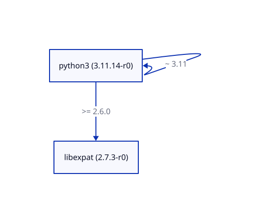
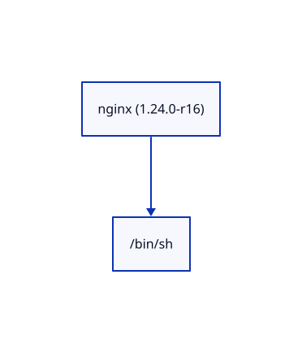

# Визуализатор графа зависимостей (apk)

## Описание
Инструмент строит граф зависимостей пакетов Alpine Linux по индексу APKINDEX. Обход графа выполняется алгоритмом DFS без рекурсии, циклические зависимости обрабатываются корректно.

Возможности:
- прямые и транзитивные зависимости пакета;
- обратные зависимости (кто зависит от пакета);
- фильтрация пакетов по подстроке;
- версии пакетов (из строки `V:` индекса);
- условия версий (`=`, `<`, `>`, `<=`, `>=`, `~`) на стрелках;
- дерево зависимостей в консоли (`--ascii`);
- изображение графа в формате SVG через D2.

## Требования
- Python 3.10 или новее
- Программа `d2` для построения изображения (https://d2lang.com)

## Запуск
    python src/main.py --package <имя> --repo <URL или путь> [--test] [--ascii] [--reverse] [--filter <подстрока>] [--output <имя>]

Пример:
    python src/main.py --package python3 --repo https://dl-cdn.alpinelinux.org/alpine/v3.19/main/x86_64/APKINDEX.tar.gz --ascii --output python3

Опции:
- `--package` — имя анализируемого пакета
- `--repo` — URL индекса APKINDEX.tar.gz или путь к тестовому файлу
- `--test` — режим тестирования: `--repo` читается как файл графа
- `--ascii` — вывод дерева зависимостей в консоль
- `--reverse` — обратные зависимости
- `--filter` — подстрока: пакеты с ней в имени не учитываются
- `--output` — имя файлов `.d2` и `.svg` (по умолчанию `graph`)

## Формат тестового файла
Каждая строка описывает пакет и его прямые зависимости:

    A: B C
    B: D
    C: D
    D:

## Примеры результатов

### curl

### python3

### nginx

## Тесты
Тестовые файлы лежат в папке `tests/`:
- `simple.txt` — граф без циклов
- `cycle.txt` — граф с циклом A → B → C → A

## Сравнение с pkgs.alpinelinux.org
Версии и зависимости сверены вручную со страницами пакетов на https://pkgs.alpinelinux.org (ветка v3.19). Результаты сравнения записаны в `results.md`.

## Ограничения
Программа пропускает записи `so:`, `cmd:`, `p:` и `!`, поэтому список зависимостей может быть короче, чем на сайте.