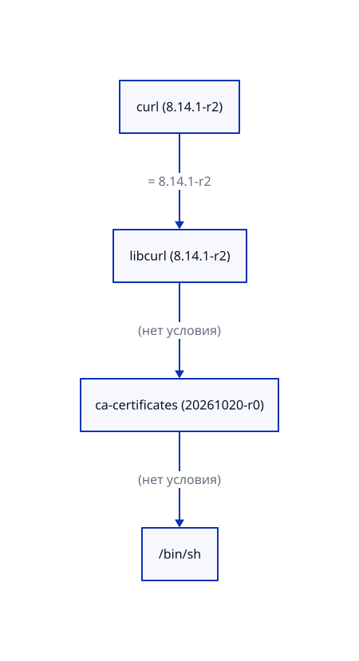

# Визуализатор графа зависимостей (apk)

## Описание
Инструмент строит граф зависимостей пакетов Alpine Linux по индексу APKINDEX. Обход графа выполняется алгоритмом DFS без рекурсии, циклы обрабатываются.

Возможности:
- прямые и транзитивные зависимости пакета;
- обратные зависимости (кто зависит от пакета);
- фильтрация пакетов по подстроке;
- версии пакетов (из строки `V:`);
- условия версий (`=`, `<`, `>`, `<=`, `>=`, `~`) на стрелках;
- дерево в консоли (`--ascii`);
- изображение графа через D2 (SVG).

## Требования
- Python 3.10 или новее
- Программа `d2` (https://d2lang.com) для изображения

## Запуск
    python src/main.py --package <имя> --repo <URL или путь> [--test] [--ascii] [--reverse] [--filter <подстрока>] [--output <имя>]

Пример:
    python src/main.py --package python3 --repo https://dl-cdn.alpinelinux.org/alpine/v3.19/main/x86_64/APKINDEX.tar.gz --ascii --output python3

## Примеры результатов

### curl

### python3

## Тесты
Тестовые файлы в папке `tests/`:
- `simple.txt` — граф без циклов
- `cycle.txt` — граф с циклом A → B → C → A

## Сравнение с pkgs.alpinelinux.org
Версии и зависимости сверены вручную со страницами пакетов на https://pkgs.alpinelinux.org (ветка v3.19). Результаты в `results.md`.

## Ограничения
Записи `so:`, `cmd:`, `p:` и `!` программа пропускает. Поэтому у некоторых пакетов список короче, чем на сайте.